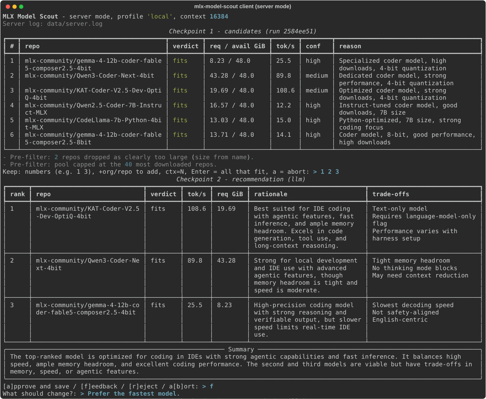
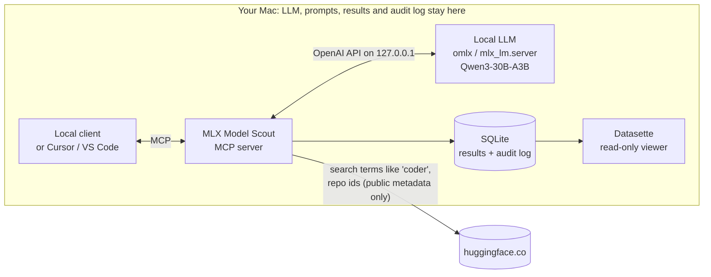
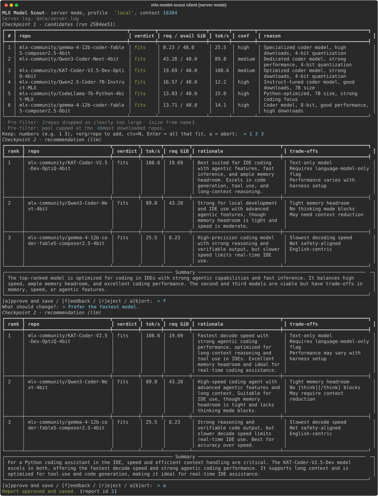
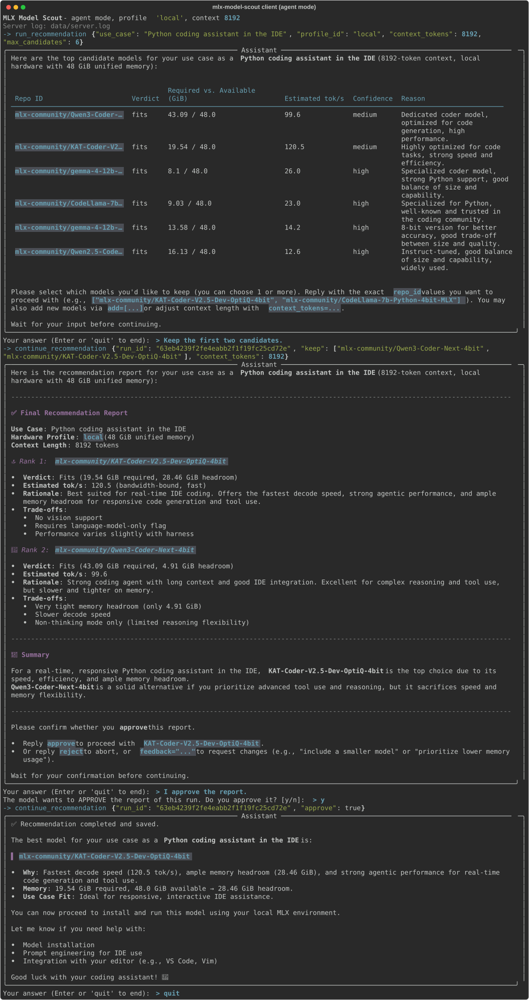
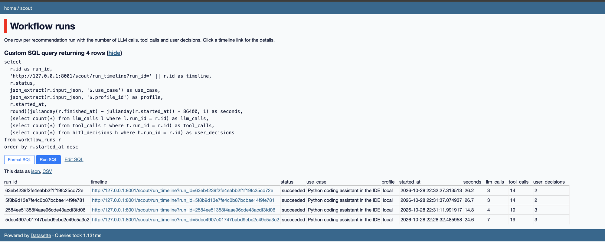
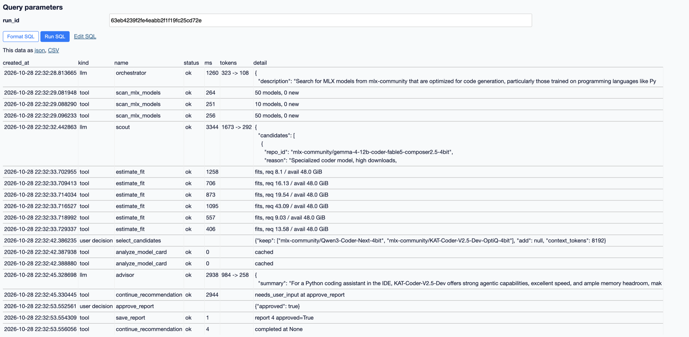
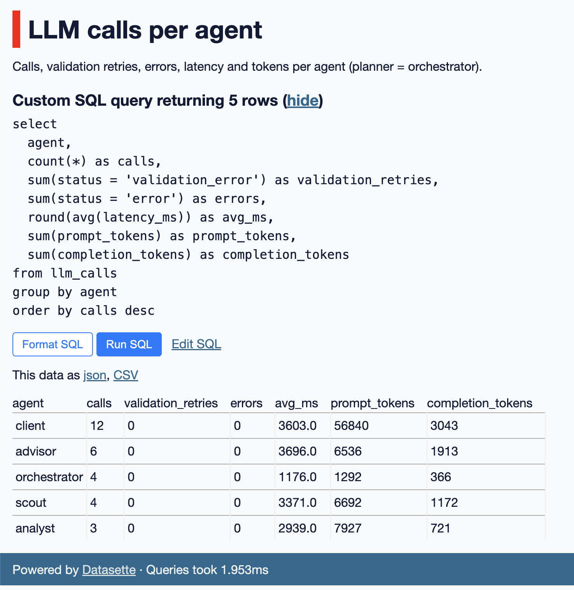
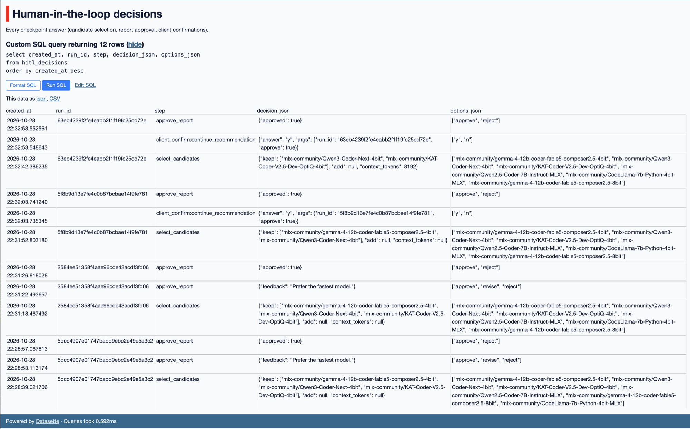
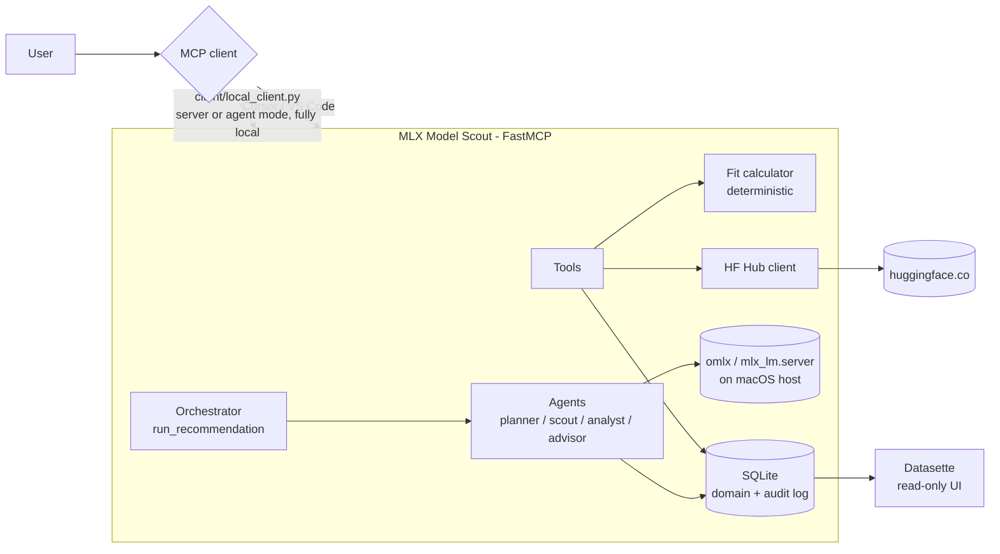
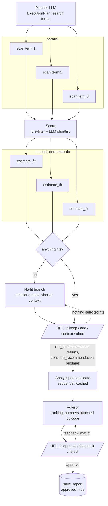

<div align="center">

# MLX Model Scout

**Find the MLX models that actually run well on *your* Mac, before you download 40 GB.**

An MCP server with a team of local AI agents that scans Hugging Face for new Apple-MLX models,<br/>
computes memory fit and decode speed for your hardware, and recommends the best ones for your use case.<br/>
**Fully local:** the agents run on an LLM on your own Mac. No cloud API, no API costs, no prompts leaving the machine.

[](https://github.com/michaelhannecke/mlx-model-scout/actions/workflows/ci.yml)




<sub>A real session on a MacBook Pro M5 Pro (64 GB): the agents shortlist coder models with memory and speed
estimates (checkpoint 1), you pick, they write a ranked recommendation (checkpoint 2), you approve or give feedback.<br/>
Every number in these tables comes from a deterministic calculator, not from the LLM.</sub>

</div>

---

## The problem

`mlx-community` alone publishes new MLX conversions every day: new architectures, MoE variants, 3/4/6/8-bit
quantizations, vision models. Whether one of them fits on a given Mac, and how fast it will be, is not on
the model page. Parameter counts on the Hub are wrong for quantized repos, the KV cache depends on the
attention layout, and macOS only lets the GPU use part of the unified memory. The usual answer is to
download the model and try it.

## What MLX Model Scout does

| | |
|---|---|
| **Scans** | the Hugging Face Hub for MLX repos, incl. "what is new since my last scan" |
| **Analyzes** | each candidate's `config.json`, actual download size and model card (architecture, quantization, MoE, KV layout, strengths, license) |
| **Computes** | memory required vs. available and decode tok/s for your Mac or any hypothetical machine (e.g. "the M5 Max with 128 GB I am thinking of buying") |
| **Recommends** | the best models for a use case in plain language ("Python coding assistant in the IDE", "German RAG over contracts") |
| **Asks you** | at two checkpoints: which candidates to keep, and whether the final report is right |
| **Records** | every LLM call, tool call and decision in a local SQLite audit log you can browse |

Ask it from your editor, from the terminal client or from code:

> *"Would `mlx-community/Qwen3-30B-A3B-Instruct-2507-4bit` fit on `mbp-m5max-128` with 32k context?"*
>
> `fits: 20.5 of 96.0 GiB, 74.7 tok/s`

## Fully local by design



- **The agents run on your hardware.** Planner, scout, analyst and advisor call an OpenAI-compatible MLX
  server on `127.0.0.1` (reference: omlx, or `mlx_lm.server`). The server
  deliberately does not use MCP sampling, which would hand generation to the client's (possibly cloud) model.
- **Your use case, prompts and reports stay on the Mac.** The only outbound traffic is to the Hugging Face Hub,
  and it only sees short search terms and the public repo ids being looked up.
- **No cloud API keys, no usage costs.** A Hugging Face token is optional (rate limits only).
- **Degrades gracefully:** without a running local LLM, scanning, analysis and fit estimation
  still work; the agent steps fall back to deterministic rules and say so.
- **Fully local end to end** with the bundled terminal client (`make client`). In Cursor or VS Code the
  *orchestrating* model is the editor's model, while the server's own agents still run locally.

## How it works

```text
  your use case ──► 1 PLAN      planner LLM picks Hub search terms
                    2 SCAN      parallel Hub scans, scout LLM shortlists candidates
                    3 COMPUTE   deterministic memory + speed estimate per candidate
                                (nothing fits? -> smaller quantizations, shorter context)
                ◄── CHECKPOINT 1  you keep / remove / add candidates or change the context
                    4 ANALYZE   analyst LLM reads each model card
                    5 ADVISE    advisor LLM ranks and explains, code checks every repo id and number
                ◄── CHECKPOINT 2  you approve, reject or ask for a revision
                    6 SAVE      approved report + full audit trail in SQLite
```

The checkpoints are enforced by the server, not by a prompt: a run cannot reach the report without a
selection, and nothing is saved as approved without an explicit approval (details in
[Recommendation workflow](#recommendation-workflow)).

## Highlights

- **The LLM never does arithmetic.** Memory and speed come from a deterministic calculator; the agents get
  them as facts, and their output is checked against the input (no invented repos, no altered numbers).
- **Grounded in measurements:** weight memory from the actual download size (exact), decode speed
  calibrated on measured tok/s for a dense and an MoE model, per-layer KV cache for sliding-window and
  linear-attention architectures ([Validation](#validation-against-real-models)).
- **Multi-agent with a safety net:** four agents with structured outputs, validation, retries and
  deterministic fallbacks; a Plan-and-Execute orchestrator with parallel, sequential and conditional steps.
- **Human in the loop by construction:** two server-side checkpoints, usable from any MCP client; the terminal
  client additionally asks for a y/n before any approving call in agent mode.
- **Plan hardware purchases:** hypothetical machines and clusters are a few lines of YAML.
- **Auditable:** every LLM call, tool call and user decision lands in SQLite and can be browsed in Datasette.
- **Security-minded:** localhost-only HTTP with DNS-rebinding protection, validated repo ids, untrusted model-card
  text marked as such, owner-only database, non-root container ([Security](#security)).

| At a glance | |
|---|---|
| MCP | 11 tools, 4 resources, 1 workflow prompt |
| Agents | planner, scout, analyst, advisor (+ deterministic calculator as a tool) |
| Clients | terminal client (server and agent mode), Cursor, VS Code, MCP Inspector, HTTP |
| Runtime | Python 3.14, FastMCP, SQLite, Apple `container` or Docker |
| Quality | ruff, pre-commit, CI, 100+ tests without network or LLM |

---

## Table of contents

- [Demo](#demo)
- [Quick start](#quick-start)
- [Usage](#usage)
- [Configuration](#configuration)
- [MCP capabilities](#mcp-capabilities)
- [Architecture](#architecture)
- [How the numbers are produced](#how-the-numbers-are-produced)
- [Required features](#required-features)
- [Custom features](#custom-features)
- [Architecture decisions](#architecture-decisions)
- [Validation against real models](#validation-against-real-models)
- [Limitations](#limitations)
- [Security](#security)
- [Troubleshooting](#troubleshooting)
- [Development](#development)
- [Roadmap](#roadmap)

## Demo

The full session from the screenshot above, including the feedback round ("Prefer the fastest model")
and the approval. The local LLM (Qwen3-30B-A3B via omlx) plans the search, shortlists, reads model cards
and writes the rationale; all numbers come from the calculator.

<details>
<summary><b>Server mode:</b> full terminal session</summary>



</details>

<details>
<summary><b>Agent mode:</b> the local LLM drives the workflow tools and talks to you in free text</summary>



</details>

**Audit log** (`make audit-ui`): every run with its LLM calls, tool calls and user decisions, and the
timeline of one run (planner, parallel scans, scout, parallel fit estimates, checkpoint 1, analyst,
advisor, checkpoint 2):





<details>
<summary>LLM calls per agent and human-in-the-loop decisions</summary>





</details>

## Quick start

Prerequisites: a Mac with Apple Silicon (macOS 26+), [uv](https://docs.astral.sh/uv/), and a local
OpenAI-compatible MLX server (omlx, or `mlx_lm.server` via `make mlx-server`) with
`Qwen3-30B-A3B-Instruct-2507-4bit` loaded.

```bash
git clone https://github.com/michaelhannecke/mlx-model-scout.git
cd mlx-model-scout
uv sync                       # installs Python 3.14 and all dependencies
cp .env.sample .env           # set SCOUT_LLM_API_KEY (omlx) and SCOUT_LLM_MODEL, see Configuration
make check                    # optional: lint + tests, no network or LLM needed
make client                   # first recommendation for "Python coding assistant in the IDE"
```

`make client` starts the MCP server in the background, scans Hugging Face, and stops twice for your
input in the terminal. To pick the model id for `SCOUT_LLM_MODEL`, ask your LLM server:
`curl -H "Authorization: Bearer <key>" http://127.0.0.1:8000/v1/models`.

Without a local LLM, everything deterministic still works (scan, analysis, fit estimation); the agent
steps fall back to deterministic rules and say so in their output.

## Usage

There are five ways to use the server. All of them share the same tools, database and audit log.

| Way | Command | LLM that orchestrates | Best for |
|---|---|---|---|
| Local client | `make client` / `make client-agent` | local (omlx) | fully local recommendations in the terminal |
| MCP client (Cursor, VS Code) | config block below | the client's model (may be cloud) | interactive use in your editor |
| MCP Inspector | `make inspect` | none (you call tools by hand) | exploring tools and schemas |
| HTTP | `make run-http` | your code | scripting, containers |
| Container | `container run ...` | your client | isolated deployment |

### Local client (fully local)

`client/local_client.py` starts the server over stdio and drives the recommendation workflow with
the local LLM; nothing leaves the machine. Human-in-the-loop happens in the terminal.

```bash
make client                                   # server mode, use case "Python coding assistant in the IDE"
make client USE_CASE="German RAG over contracts"
make client-agent                             # agent mode
uv run python client/local_client.py "German RAG over contracts" --profile studio-m4max-64 --context 32768
```

| Option | Default | Meaning |
|---|---|---|
| `use_case` (positional) | - | what the model should do |
| `--profile` | `local` | hardware profile id (`local` = this Mac; others from `config/hardware_profiles.yaml`) |
| `--context` | `8192` | target context length in tokens |
| `--mode` | `server` | `server` or `agent` (see below) |
| `--max-candidates` | `6` | candidates the scout shortlists |
| `--record PATH` | - | save the terminal session as SVG |

| Mode | How it works | When to use |
|---|---|---|
| `server` (default) | Calls `run_recommendation`, renders checkpoint 1 as a table, then the report, resuming with `continue_recommendation`. | Robust, reproducible use. |
| `agent` | The local LLM is a conversational front end: it receives a curated tool set (workflow tools + read-only lookups) in OpenAI tool-calling format, talks to you in free text and turns answers into tool calls (e.g. "keep the first two" -> `keep=[...]`). Any approving call needs a y/n confirmation first. | Shows local tool calling and natural-language HITL. |

Answers in server mode:

| Checkpoint | Input | Effect |
|---|---|---|
| 1, candidates | `1 3` | keep candidates 1 and 3 |
| | `+mlx-community/<repo>` | add a repo to evaluate |
| | `ctx=16384` | re-evaluate with another context length |
| | Enter / `a` | keep all that fit / abort |
| 2, report | `a` / `f` / `r` / `b` | approve and save / give feedback (revised report, max 2) / reject / abort |

`SCOUT_*` variables from the shell are forwarded to the server subprocess (e.g. a separate
`SCOUT_DB_PATH`); server stderr goes to `server.log` next to the database.

### From an MCP client (Cursor, VS Code)

**Cursor** (`~/.cursor/mcp.json` or `.cursor/mcp.json`):

```json
{
  "mcpServers": {
    "mlx-model-scout": {
      "command": "uv",
      "args": ["--directory", "/absolute/path/to/mlx-model-scout", "run", "mlx-model-scout"],
      "env": {
        "SCOUT_LLM_BASE_URL": "http://127.0.0.1:8000/v1",
        "SCOUT_LLM_API_KEY": "your-omlx-api-key",
        "SCOUT_LLM_MODEL": "Qwen3-30B-A3B-Instruct-2507-4bit",
        "SCOUT_HF_TOKEN": "hf_your_read_token_optional"
      }
    }
  }
}
```

**VS Code** (GitHub Copilot agent mode, `.vscode/mcp.json`). VS Code asks for the API key once
instead of storing it in the file:

```json
{
  "inputs": [
    { "type": "promptString", "id": "omlx-key", "description": "omlx API key", "password": true }
  ],
  "servers": {
    "mlx-model-scout": {
      "type": "stdio",
      "command": "uv",
      "args": ["--directory", "/absolute/path/to/mlx-model-scout", "run", "mlx-model-scout"],
      "env": {
        "SCOUT_LLM_BASE_URL": "http://127.0.0.1:8000/v1",
        "SCOUT_LLM_API_KEY": "${input:omlx-key}",
        "SCOUT_LLM_MODEL": "Qwen3-30B-A3B-Instruct-2507-4bit"
      }
    }
  }
}
```

Example requests in the chat:

- *"Run the recommendation workflow for 'German RAG over contracts' on profile local."*
  (uses `run_recommendation` and stops at both checkpoints for your answer)
- *"Would mlx-community/Qwen3-30B-A3B-Instruct-2507-4bit fit on mbp-m5max-128 with 32k context?"*
- *"Which new MLX coder models appeared since my last scan?"*
- or the prompt `recommend_models` (use case, profile, context), where the client's model orchestrates the tools.

Note: in Cursor and VS Code the *orchestrating* model is the client's model (possibly cloud). The
server's own agents still use the local LLM. For a fully local run use the local client.

### MCP Inspector

```bash
make inspect      # needs Node.js; opens the MCP Inspector UI against the stdio server
```

### Over HTTP (programmatic use)

```bash
make run-http     # streamable HTTP on http://127.0.0.1:8765/mcp (no auth, localhost only)
```

```python
import asyncio

from fastmcp import Client


async def main():
    async with Client("http://127.0.0.1:8765/mcp") as client:
        result = await client.call_tool(
            "estimate_fit",
            {
                "repo_id": "mlx-community/Qwen3-30B-A3B-Instruct-2507-4bit",
                "profile_id": "mbp-m5max-128",
                "context_tokens": 32768,
            },
        )
        fit = result.structured_content
        print(
            f"{fit['verdict']}: {fit['required_gb']} of {fit['available_gb']} GiB, {fit['est_decode_tps']} tok/s"
        )


asyncio.run(main())
```

Output: `fits: 20.5 of 96.0 GiB, 74.7 tok/s`.

### In a container

The image is a standard OCI image. Primary target is **Apple `container`** (macOS 26); Docker/Podman work too.

```bash
container system start                         # once per boot
container build -t mlx-model-scout:latest .    # or: make image
container run --rm -p 127.0.0.1:8765:8765 -v scout-data:/data \
  -e SCOUT_LLM_BASE_URL=http://<host-gateway-ip>:8000/v1 -e SCOUT_LLM_API_KEY=<key> mlx-model-scout:latest
```

Compose (server + Datasette UI for the audit DB on http://127.0.0.1:8001):

```bash
container build -t mlx-model-scout:latest .
container compose up        # community plugin, see note
# or: docker compose up --build
```

Apple `container` has **no built-in compose** (Apple closed the upstream PR in April 2026 and points to plugins).
Use the community plugin [andrew-waters/compose](https://github.com/andrew-waters/compose) (`container compose`),
or `apple-compose`; both cannot build images, hence the explicit `container build` first.

Inside a container: no Metal/GPU, no host hardware detection (use profile ids, not `local`),
HTTP transport without auth (published on `127.0.0.1` only). To use the host's LLM, the LLM server
must listen on the container network's gateway address (`container network list`), not only on
`127.0.0.1`; without it, the LLM-backed tools degrade to their deterministic fallbacks.

### Database (SQLite)

No database server and no setup step: on first start the server creates the SQLite file at
`SCOUT_DB_PATH` (default `./data/scout.db`, gitignored) with all tables (`SQLModel.metadata.create_all`).
To start over, stop the server and delete the file; it is recreated on the next start.

| Tables | Content |
|---|---|
| `hub_models`, `scan` | repos seen on the Hub and scan history (for "new since last scan") |
| `model_specs` | analyzed `config.json` facts and cached model-card insights |
| `fit_estimates`, `reports`, `benchmarks` | estimates, saved reports (with approval flag), mock benchmarks |
| `run_states` | state of recommendation runs between the two checkpoints |
| `workflow_runs`, `llm_calls`, `tool_calls`, `hitl_decisions` | audit log |

With compose, the server and Datasette share the database through the `scout-data` volume
(`docker compose up --build`, or `container compose up` after `container build`, see
[In a container](#in-a-container)). The file is named `compose.yaml`, the default name of the
Compose specification; `docker-compose.yml` is the older name and `docker compose` finds either.

### Audit log (Datasette)

```bash
make audit-ui     # read-only Datasette on http://127.0.0.1:8001 with canned queries
```

Canned queries (`config/datasette.yml`): **Workflow runs** (with a clickable timeline per run),
**Run timeline**, **LLM calls per agent**, **Human-in-the-loop decisions**, **Saved reports**.
Prompts are stored truncated (500 characters) plus a SHA-256 hash unless `SCOUT_LOG_FULL_MESSAGES=true`.
`make purge-logs` deletes audit rows older than `SCOUT_LOG_RETENTION_DAYS`.

### Hardware profiles

`local` is detected on the Mac (chip incl. GPU core count, memory, GPU wired limit). Hypothetical
machines live in `config/hardware_profiles.yaml`; add one to plan a purchase:

```yaml
  - id: planned-mbp-128
    name: "MacBook Pro M5 Max 40c, 128 GB (planned)"
    chip: m5-max-40c            # key from config/chips.yaml (bandwidth from Apple's specs)
    unified_memory_gb: 128
    reserved_gb: 16             # keep free for OS and apps
    # wired_limit_gb: 112       # optional, else 75% of unified memory
    # nodes: 2                  # optional cluster: memory summed, no speed estimate
```

## Configuration

All variables use the `SCOUT_` prefix and can be set in `.env` (see [`.env.sample`](.env.sample)).
**No paid API keys are required.** Never commit `.env` (a pre-commit hook blocks it).

| Variable | Required | Default | Purpose |
|---|---|---|---|
| `SCOUT_LLM_BASE_URL` | for agents | `http://127.0.0.1:8000/v1` | local OpenAI-compatible MLX server (omlx / mlx_lm.server) |
| `SCOUT_LLM_MODEL` | for agents | `Qwen3-30B-A3B-Instruct-2507-4bit` | exact id from `GET /v1/models` (omlx: no `mlx-community/` prefix; mlx_lm.server: full repo id) |
| `SCOUT_LLM_API_KEY` | for omlx | `not-needed` | the key configured in omlx (local only, not a paid key); mlx_lm.server ignores it |
| `SCOUT_HF_TOKEN` | no | - | Hugging Face read token, only raises rate limits ([create one](https://huggingface.co/settings/tokens)) |
| `SCOUT_HF_AUTHORS` | no | `["mlx-community"]` | Hub organisations to scan (JSON list) |
| `SCOUT_HF_SCAN_LIMIT` | no | `50` | repos per author and search term |
| `SCOUT_TRANSPORT` | no | `stdio` | `stdio` or `http` |
| `SCOUT_HTTP_HOST` / `SCOUT_HTTP_PORT` | no | `127.0.0.1` / `8765` | HTTP transport address |
| `SCOUT_HTTP_ALLOWED_HOSTS` | no | loopback only | accepted `Host` headers for the HTTP transport (JSON list, fnmatch patterns); DNS-rebinding protection, change only behind a proxy |
| `SCOUT_LOG_LEVEL` | no | `INFO` | server log level (logs go to stderr; the local client sets `WARNING`) |
| `SCOUT_DB_PATH` | no | `./data/scout.db` | SQLite file (domain data + audit log) |
| `SCOUT_DB_WAL` | no | `true` | set `false` when the DB is shared across container VMs |
| `SCOUT_LOG_FULL_MESSAGES` | no | `false` | store full prompts/responses instead of truncated + hash |
| `SCOUT_LOG_TRUNCATE_CHARS` / `SCOUT_LOG_RETENTION_DAYS` | no | `500` / `30` | audit-log truncation and retention |
| `SCOUT_DEFAULT_CONTEXT_TOKENS` | no | `8192` | context length when none is given |
| `SCOUT_DEFAULT_WIRED_FRACTION` | no | `0.75` | GPU-usable share of memory if no wired limit is set |
| `SCOUT_RUNTIME_OVERHEAD_GB` | no | `1.5` | runtime memory on top of weights + KV cache |
| `SCOUT_BANDWIDTH_EFFICIENCY_DENSE` / `_MOE` | no | `0.8` / `0.6` | share of peak bandwidth reached in decode |
| `SCOUT_TIGHT_HEADROOM_GB` | no | `4.0` | below this headroom a fit is rated `tight` |

## MCP capabilities

**Tools**

| Tool | Parameters | Description |
|---|---|---|
| `detect_hardware` | - | Detect local Mac (chip, memory, GPU wired limit) |
| `list_hardware_profiles` | - | Configured + detected profiles |
| `scan_mlx_models` | `search?`, `limit?` | Newest repos from HF authors; reports new since last scan |
| `analyze_model` | `repo_id` | Architecture facts from `config.json` plus actual download size |
| `analyze_model_card` | `repo_id`, `refresh?` | Analyst agent (local LLM): use cases, strengths, caveats, verified benchmarks from the base model's card; cached |
| `estimate_fit` | `repo_id`, `profile_id`, `context_tokens?` | Memory fit + decode estimate |
| `run_recommendation` | `use_case`, `profile_id?`, `context_tokens?`, `max_candidates?` | Server-side multi-agent run; stops at checkpoint 1 with `needs_user_input` |
| `continue_recommendation` | `run_id`, `keep?`, `add?`, `context_tokens?`, `approve?`, `feedback?`, `abort?` | Resume with the user's decision; checkpoint 2 returns the report, `approve=true` saves it |
| `save_report` | `report`, `approved` | Persist report after user approval |
| `run_benchmark` | `repo_id`, `profile_id`, `context_tokens?` | **Mock** benchmark (labelled) |
| `download_model` | `repo_id`, `confirmed` | **Mock**; requires confirmation |

**Resources:** `hardware://profiles`, `hardware://chips`, `catalog://models`, `runs://recent`

**Prompt:** `recommend_models(use_case, profile_id="local", context_tokens=8192)` with two human-in-the-loop checkpoints.

## Architecture



### Recommendation workflow

The same flow exists twice: as the MCP prompt `recommend_models` (the MCP client's model
orchestrates the tools) and server-side as `run_recommendation` / `continue_recommendation`
(local LLM agents orchestrated by `agents/orchestrator.py`). The server-side variant:



| Pattern | Where |
|---|---|
| Plan-and-Execute | Planner LLM produces an `ExecutionPlan` (validated, keyword fallback); the orchestrator executes it |
| Parallel | Hub scans per search term and fit estimates per candidate (`asyncio.gather`) |
| Sequential | Planner -> scout -> calculator -> analyst -> advisor; card analyses one after another (one local LLM) |
| Conditional branching | "Nothing fits" -> smaller quantized siblings + largest fitting context; feedback -> revision loop |
| Human-in-the-loop | Two checkpoints via a two-call protocol (`needs_user_input` + `continue_recommendation`) |
| Multi-agent | Planner, scout, analyst, advisor with distinct roles and structured outputs; deterministic calculator as a tool |

### Project structure

```text
src/mlx_model_scout/
  server.py              # FastMCP app factory + entry point (create_app, main)
  routers/               # thin MCP registration: tools.py, resources.py, prompts.py (delegate only)
  tools/                 # tool implementations (audit-logged)
  prompts/               # prompt texts (recommend_models workflow)
  resources/             # resource implementations: hardware, catalog, runs (read-only)
  agents/                # llm.py (only LLM entry point: chat, structured_call, chat_with_tools),
                         #   orchestrator (plan-and-execute + HITL), scout, analyst, advisor
  app/                   # pure core logic: fit_calculator, model_spec, model_card, alternatives,
                         #   hf_client, hardware, profiles
  db/                    # SQLModel tables (domain, run_states, audit), session, audit helpers
  schemas/               # Pydantic models: hardware, model, fit/report, agents (LLM outputs, runs)
  config/settings.py     # pydantic-settings (SCOUT_* env vars)
  utils/                 # logging (stderr only!)
client/local_client.py   # fully local MCP client: server mode + agent mode, terminal HITL (rich)
config/                  # hardware_profiles.yaml, chips.yaml (editable), datasette.yml (audit-log views)
tests/                   # pytest, no network / no LLM needed
docs/images/             # screenshots and recorded sessions used in this README
```

## How the numbers are produced

Deterministic, no LLM arithmetic:

| Quantity | Formula |
|---|---|
| Weights | actual size of the repo's safetensors files (Hub API); fallback `total_params x (bits + quant_overhead) / 8` (4-bit, group 64 -> 4.5 bit/weight) |
| KV cache | per layer `2 x kv_heads x head_dim x tokens x 2 bytes`; tokens = context (full attention) or `min(context, window)` (sliding window) |
| Available | `min(GPU wired limit, unified memory - reserved) x nodes` |
| Decode tok/s | `bandwidth x efficiency / (active weight bytes + KV bytes)` (bandwidth-bound; efficiency 0.8 dense, 0.6 MoE, measured) |

Parameters are computed from `config.json`, **not** from the Hub's safetensors metadata, which is
wrong for quantized MLX repos (weights are packed into uint32).

The reasoning behind each formula is in [Architecture decisions](#architecture-decisions) (5-16), the
comparison with real repos and measured speeds in [Validation](#validation-against-real-models).

## Required features

| Requirement | Implementation |
|---|---|
| FastMCP server in Python | `src/mlx_model_scout/server.py` |
| Meaningful tool(s) | HF scanning, config analysis, deterministic fit estimation, multi-agent recommendation |
| Prompt with agentic workflow + user feedback | `recommend_models`: candidate selection (HITL 1) and report approval (HITL 2) |
| Public GitHub repo | [github.com/michaelhannecke/mlx-model-scout](https://github.com/michaelhannecke/mlx-model-scout) |
| uv with Python 3.14 | `uv init --python 3.14.0`, `uv.lock`, `.python-version` |
| Organized structure | see [Project structure](#project-structure) |
| README, `.env.sample`, no secrets | this file, `.env.sample`, pre-commit `no-dotenv` hook |
| MCP client JSON configuration | Cursor and VS Code blocks in [Usage](#from-an-mcp-client-cursor-vs-code) |

## Custom features

| Feature | Status | Implementation |
|---|---|---|
| Third-party API integration | done | Hugging Face Hub REST API (`app/hf_client.py`) |
| MCP resources | done | profiles, chips, model catalog, recent runs |
| Database backend + compose | done | SQLite via SQLModel (domain data, run state, audit log; created automatically), `compose.yaml` with server + Datasette viewer, `make audit-ui`; setup in [Database](#database-sqlite) |
| Code quality & DevOps | done | ruff, pre-commit, GitHub Actions CI, Dockerfile (Apple container / Docker) |
| Structured outputs | done | Analyst (`CardExtraction`), scout (`CandidateList`) and advisor (`AdvisorDraft`) use `structured_call` (schema in prompt, Pydantic validation, retry with error feedback), then code validates the content against the input; tested with a fake LLM incl. retry and fallback paths |
| Multi-agent orchestration | done | Plan-and-Execute orchestrator coordinating planner, scout, analyst and advisor agents (`agents/`), exposed as `run_recommendation` / `continue_recommendation` |
| MCP client application | done | `client/local_client.py`: fully local client with custom orchestration (server mode) and a local-LLM agent loop with tool calling (agent mode), terminal HITL, see [Local client](#local-client-fully-local) |
| Workflow patterns | done | parallel scans and fit estimates, sequential agent pipeline, conditional "no fit" branch and revision loop, see [Recommendation workflow](#recommendation-workflow) |
| Advanced agentic pattern (Plan-and-Execute) | done | the planner LLM produces a validated `ExecutionPlan` (search terms, vision need); the orchestrator executes it with parallel scans, the scout, deterministic fit estimates and the analyst/advisor agents (`agents/orchestrator.py`) |
| Human-in-the-loop "AI generation -> validation" | done | the system proposes candidates and drafts a ranked report; the user selects, adds or changes the context (checkpoint 1), then approves, rejects or requests a revision with feedback (checkpoint 2, re-ranked draft). The terminal client renders both as tables, and in agent mode every approving call needs an explicit y/n confirmation. All decisions are logged |

## Architecture decisions

Each decision lists what was chosen and why. They are binding for contributors.

### Scope and privacy

| # | Decision | Rationale |
|---|---|---|
| 1 | **Advisory only.** No real downloads or benchmarks; `download_model` and `run_benchmark` are mocks with final interfaces, results labelled `source="mock"`. | Downloading tens of GB per candidate is not useful for planning; the interfaces let a real implementation be added later without changing clients. |
| 2 | **Fully local LLM.** All agent LLM calls go to an OpenAI-compatible MLX server on the Mac (omlx as the reference, `mlx_lm.server` as the alternative). No cloud LLM APIs. | Privacy and cost; the project is about local inference on Apple Silicon. Using the OpenAI wire format keeps the server swappable. |
| 3 | **No FastMCP `ctx.sample()`.** | Sampling delegates generation to the MCP *client's* model, which may be a cloud model, and would break decision 2. |
| 4 | **Single LLM entry point** (`agents/llm.py`: `chat`, `structured_call`, `chat_with_tools`). | Every call is audit-logged and uses the same retry/validation logic. |

### Estimation (deterministic core)

| # | Decision | Rationale |
|---|---|---|
| 5 | **The LLM never does arithmetic.** Memory and speed numbers come only from `app/fit_calculator.py`; agents receive them as facts. After an LLM ranks results, repo ids and numbers are validated against the input. | LLMs make arithmetic errors and hallucinate numbers; a sizing tool must be reproducible. |
| 6 | **Parameters are computed from `config.json`**, not taken from the Hub's safetensors metadata; including linear-attention layers (Gated DeltaNet projections) and gated attention (`attn_output_gate`). They drive the speed estimate (active params) and the memory fallback. | For quantized MLX repos the Hub's parameter count is wrong (weights packed into uint32 plus scales/biases). Hybrid layers were under-counted by 9% (Qwen3.8-27B: 24.35B -> 26.9B) until checked against the safetensors index. |
| 7 | **Quantization overhead is modelled explicitly:** affine `bits + 32/group_size` (fp16 scale + bias per group, 4-bit/g64 = 4.5 bit), MX formats `bits + 8/group_size`, no block = bf16. | Ignoring scales/biases under-estimates 4-bit models by ~12%. |
| 8 | **Weight memory = actual download size** of the repo's `.safetensors` files (one Hub API call in `analyze_model`); the parameter formula is only the fallback. | MLX loads the files as stored, so this is exact and also covers vision towers and per-layer mixed precision, which the formula missed (gemma-3 -10%, gpt-oss -8%, Qwen3.8 -6%). Errors in this direction would claim a fit that does not exist. |
| 9 | **Omitted config defaults are filled per model type** (e.g. Gemma 3: `vocab_size`, tied embeddings). | `transformers` drops keys equal to class defaults when saving `config.json`; without them the count falls back to a name guess. |
| 10 | **Per-layer quantization overrides lower confidence** (e.g. gpt-oss: 8-bit attention, MXFP4 experts). MoE router overrides (`mlp.gate`) are ignored. | Weights are estimated at the base bit width; routers are too small to matter. |
| 11 | **MoE: memory uses total params, speed uses active params** (active experts + attention + lm_head, without the input-embedding table). | All experts must be resident, but a decoded token only reads the routed ones; embedding lookup reads one row. |
| 12 | **KV cache per layer type:** `2 x kv_heads x head_dim x tokens x 2 bytes` per layer, with tokens = context for full attention and `min(context, window)` for sliding-window layers; linear-attention layers (Qwen3-Next) add nothing (small constant state). The layout comes from `layer_types` (gpt-oss, Gemma 4, incl. separate global KV heads/head dim), `sliding_window_pattern` (Gemma 3, default 6) or `full_attention_interval` (Qwen3-Next). A bare `sliding_window` without a pattern is ignored (Qwen2 sets but disables it). MLA (DeepSeek V2/V3, Kimi K2) and SSM/Mamba hybrids get **no KV estimate and low confidence**. | MLX keeps a rotating cache for sliding layers; counting them at full context over-estimated Gemma 4's KV cache 15x (12 GiB vs 0.8 GiB at 32k) and under-estimated its speed 2.6x. Where the layout is unknown, a flagged gap beats a wrong number. |
| 13 | **Usable memory** = `min(GPU wired limit, unified memory - reserved)`. The wired limit is read from `sysctl iogpu.wired_limit_mb`; if unset, 75% of unified memory is assumed. | macOS caps how much unified memory the GPU may wire; total RAM is not the right budget. |
| 14 | **Decode speed is memory-bandwidth-bound:** `bandwidth x efficiency / (active weight bytes + KV bytes)` with efficiency 0.8 for dense and 0.6 for MoE models. Bandwidth comes from Apple's spec sheets (`config/chips.yaml`); unverified/unknown chips get no speed estimate rather than a guess. | Token generation reads all active weights once per token. Measured on an M5 Pro: dense Qwen3.8-27B reaches ~83% of peak, MoE Qwen3-30B-A3B ~59% (many small expert matmuls and routing); one factor for both under-estimated dense models by ~25% (see [Validation](#validation-against-real-models)). |
| 15 | **Local chip detection** uses the CPU brand string plus the GPU core count from `system_profiler SPDisplaysDataType`. If the exact variant is not in `chips.yaml`, the largest known variant is assumed and flagged in the profile notes. | M5 Max 32c (460 GB/s) and 40c (614 GB/s) differ by 33% in bandwidth; the brand string alone cannot tell them apart. |
| 16 | **Clusters** (`nodes > 1`): memory is summed, no speed estimate. | Multi-node decode is interconnect-bound and not modelled. |
| 17 | **Hardware profiles are data, not code:** detected (`local`) or hypothetical (`config/hardware_profiles.yaml`, editable). | Allows planning purchases ("would a 128 GB M5 Max run X?") without code changes. |
| 18 | **Units:** memory in GiB (2^30), bandwidth in GB/s (10^9). | Matches how Apple advertises memory and bandwidth. |

### Agents and workflow

| # | Decision | Rationale |
|---|---|---|
| 19 | **Structured output without constrained decoding:** JSON schema in the system prompt -> parse (strip a *leading* `<think>` block and code fences; `<think>`/`<tool_call>` tags in card text are rewritten to `[think]` before prompting, since they are special tokens for Qwen3 and get garbled) -> Pydantic validation -> retry with the validation error. Output models are kept small and flat. | Local MLX servers do not guarantee schema-constrained decoding; small local models fail on deeply nested schemas. |
| 20 | **Human-in-the-loop is mandatory** at two points of `recommend_models`: candidate selection and report approval. `save_report(approved=True)` and `download_model(confirmed=True)` only after explicit consent; decisions are logged. | Course requirement, and the user, not the model, should decide what gets saved or downloaded. |
| 21 | **Multi-agent design:** planner -> scout -> fit estimates (parallel) -> analyst per candidate (sequential) -> advisor, coordinated by a Plan-and-Execute orchestrator (`agents/orchestrator.py`); conditional "no fit" branch suggests smaller quantizations or a shorter context. | Separates planning, search, per-model analysis and ranking. Deterministic steps run in parallel; LLM steps run sequentially because one local LLM server answers one request at a time. |
| 22 | **The analyst reads the base model's card**, found via the "converted to MLX format from ..." line (more reliable than the front-matter `base_model`), and falls back to the repo card unless it is conversion boilerplate. | `mlx-community` cards contain only metadata and a usage snippet; the prose that describes strengths and caveats lives in the original card. |
| 23 | **Card facts are split by source:** `license`, `base_model`, `pipeline_tag` come from YAML front matter (deterministic); the LLM only fills a small flat `CardExtraction` (summary, use cases, languages, strengths, caveats, benchmarks). Benchmark scores are kept only if the number appears verbatim in the card, and are capped at 10 in code. | Keeps the LLM away from facts that are already structured; guards against invented numbers. Local models ignore "max N" in a schema description, so limits are enforced after validation. |
| 24 | **Graceful degradation:** if the LLM is unreachable or never returns valid JSON, `analyze_model_card` returns the metadata with `llm_used=false` and a note; gated base cards (HTTP 401/403) are reported in `notes`. Only successful LLM results are cached (`model_specs.card_insights_json`). | One failing component must not break the workflow; a degraded result must not hide a later successful analysis. |
| 25 | **Card analysis is a separate tool** (`analyze_model_card`), not a flag on `analyze_model`. | Different cost profile (LLM call, seconds vs. milliseconds) and a distinct, typed return model the client model can rely on. |
| 26 | **Scout = deterministic pre-filter + LLM shortlist.** Code drops non-LLM pipelines (ASR, TTS, embeddings, ...) and repos whose name-based size clearly exceeds available memory, and caps the pool at 40 (most downloaded). The LLM then picks up to N candidates from that list; ids not in the list are dropped. | Keeps the prompt small for a local model and avoids spending LLM time on impossible candidates. The name-based size is only a filter; reported numbers always come from `config.json`. |
| 27 | **Advisor output carries no numbers.** The LLM gets the calculator's facts but returns only order, rationale and trade-offs (`AdvisorDraft`); code attaches each `FitEstimate` unchanged. Repo ids outside the usable (`fits`/`tight`) set are dropped, max 5 ranks. Any number+unit (GiB, tok/s) the LLM writes anyway must match the facts, otherwise the text is replaced. | Enforces decision 5 by construction instead of by prompt; the LLM decides suitability, never sizing. |
| 28 | **Every agent has a deterministic fallback** (scout: most downloaded; advisor: rank by verdict, speed, headroom; analyst: metadata only), and results record `llm_used` / `generated_by` plus `notes` for every correction. | The workflow still completes when the local LLM is down or misbehaves, and the user can see what was model judgement and what was corrected. |
| 29 | **Human-in-the-loop via a two-call protocol:** `run_recommendation` stops at checkpoint 1 and returns `status="needs_user_input"` with the data and instructions; `continue_recommendation(run_id, ...)` applies the decision and stops at checkpoint 2. No MCP elicitation. | Works with every MCP client and with the local client; elicitation support in clients like Cursor is uncertain. The tool docstrings tell the client model to ask the user and never decide itself. |
| 30 | **Run state is persisted per `run_id`** (`run_states` table, `RunState` as JSON); finished runs reject further calls. Every decision is logged (`log_hitl`), every tool call carries the `run_id`, `workflow_runs` records succeeded/aborted/failed. | Runs survive between tool calls and server restarts and are fully traceable in the audit log. |
| 31 | **Planner output is validated:** search terms are lower-cased, must be short name-like tokens, max 3, deduplicated; otherwise a keyword fallback (`code` -> `coder`, `image` -> `vl`, always `instruct`). | Local models sometimes return sentences or full model names, which make poor Hub searches. |
| 32 | **No-fit branch is deterministic:** smaller quantizations are found by searching the Hub for the same base name (quant suffixes stripped) and estimated in parallel; the largest fitting context is found by halving. It runs whenever checkpoint 1 would show nothing that fits, also after the user's selection. | Concrete, verified alternatives instead of an LLM guessing what might fit. |
| 33 | **Feedback at checkpoint 2 re-runs only the advisor** (max 2 revisions); feedback is appended to the use case for the advisor but not stored in the report. Rejection stores the report with `approved=false`. | Cheap revisions (card analyses are cached) with an upper bound against endless loops; rejections remain auditable. |
| 34 | **`continue_recommendation` rejects decisions for the wrong checkpoint** (e.g. `approve` at `select_candidates`) with an error that says what is expected; the run stays usable. | Observed: a local model tried to skip checkpoint 1 by approving right away, which silently became "keep all". The server, not the client model, guarantees the two checkpoints. |
| 35 | **Local client has two modes: server (default) and agent.** Agent mode gives the local LLM only the workflow tools plus read-only lookups (`run_recommendation`, `continue_recommendation`, `list_hardware_profiles`, `estimate_fit`, `analyze_model_card`), not the `recommend_models` prompt with all tools. | Tested with Qwen3-30B-A3B on the full prompt flow: it invented a `run_id`, skipped checkpoint 1 and wrote and saved its own report via `save_report`, bypassing the advisor's validation. With the curated set the same model completed the workflow correctly. The prompt flow stays for capable client models. |
| 36 | **Client-side HITL guard:** in agent mode any approving call (`continue_recommendation approve=true`, `save_report approved=true`, `download_model confirmed=true`) requires a y/n confirmation in the terminal, logged via `log_hitl` with the run's id; tools outside the curated set are refused. | Defense in depth: the model cannot approve on the user's behalf even if it misreads the conversation. |
| 37 | **The client never creates its own OpenAI client;** it uses the audit-logged `chat_with_tools` in `agents/llm.py`. | Keeps decision 4: every LLM call, including the client's tool-calling turns, lands in the audit log. |
| 38 | **Qualitative memory/speed labels are computed by code** and given to the advisor: memory headroom `ample` (>= 50% of available) / `moderate` (>= 20%) / `tight`, and `speed rank i of n (fastest/slowest)`. The prompt tells the model to base every memory/speed statement on them. | Observed: given raw GiB values, the local model called 28 of 48 GiB headroom "tight" and an 8 GiB model a "large memory footprint". With computed labels the statements matched the numbers in the re-run. |

### Persistence and observability

| # | Decision | Rationale |
|---|---|---|
| 39 | **SQLite (SQLModel) for domain data and an own audit log** of every LLM call, tool call, workflow run and HITL decision, viewable with Datasette (canned queries in `config/datasette.yml`). No Opik/Phoenix. | Fully local, zero extra services, inspectable with standard tools. |
| 40 | **Privacy default:** prompts/responses stored truncated + SHA-256 (`SCOUT_LOG_FULL_MESSAGES=false`), retention via `make purge-logs`. | The audit log should not become a copy of everything the user typed. |
| 41 | **No migrations yet:** tables are created on startup; column changes require recreating `data/scout.db`. | Acceptable for a single-user tool at this stage. |

### Code structure and operations

| # | Decision | Rationale |
|---|---|---|
| 42 | **Layering:** `routers/` (thin MCP registration) -> `tools/` (audited implementations) -> `app/` (pure logic). `app/` never imports from `tools/`, `routers/` or `agents/`. | The core stays unit-testable without MCP or LLM. |
| 43 | **stdout belongs to MCP** in stdio mode; all logging goes to stderr. | Any `print()` corrupts the JSON-RPC stream. |
| 44 | **Tests need no network and no LLM** (`httpx.MockTransport`, fake OpenAI client, temporary SQLite per test). | Reliable CI; real-world checks are done separately (see Validation). |
| 45 | **Apple `container` is the primary container runtime, Docker the fallback** (and used in CI). The LLM always runs on the host. | Native to macOS 26; there is no Metal/GPU inside containers, and GitHub runners cannot run Apple `container`. |
| 46 | **HTTP transport has no auth, is published on `127.0.0.1` only, and validates `Host`/`Origin`** (fastmcp's guard in strict mode, loopback allowlist `SCOUT_HTTP_ALLOWED_HOSTS`): foreign `Host` -> 421, foreign browser `Origin` -> 403. | Single-user local tool; exposing it on the LAN would need authentication first. Binding to localhost alone does not stop DNS rebinding: tested, the server accepted `Host: evil.example` until the guard (off by default in fastmcp 4.1) was enabled. |
| 47 | **No SQLite WAL in compose** (`SCOUT_DB_WAL=false`), Datasette with `--nolock`; no `env_file` in compose. | Each Apple container is its own VM, so WAL shared memory does not work across them; the host `.env` holds host paths that would override container defaults. |
| 48 | **Secrets only in `.env`** (gitignored, blocked by a pre-commit hook); `.env.sample` holds fake values. | Course requirement and basic hygiene. |
| 49 | **Hub repo ids are validated at the HTTP boundary** (`app/hf_client.validate_repo_id`: `org/name`, allowed characters, no `..`) before they are put into URL paths. | repo ids come from tool arguments (client model, LLM, user) and model cards, and Hub requests carry the HF token. Tested: `../api/whoami-v2` or `a/b?x=1` reached other Hub endpoints before (the host itself cannot change; httpx also drops the token on cross-host redirects). |
| 50 | **Model-card text is untrusted data:** LLM output derived from cards is length-capped in code (summary 300 chars, lists 5 x 120 chars; advisor rationale 400 chars) and the tool docstring tells client models to treat it as data, not instructions. Agent mode additionally restricts tools and requires y/n for approvals. | Cards are third-party content that reaches the analyst LLM and, through tool results, the client's model, which may have other tools (terminal, files): a prompt-injection surface. Caps keep the payload small; the guard keeps approvals human. |

## Validation against real models

Estimates were checked on 2026-10-28 against real `mlx-community` repos and against measured decode
speeds on a MacBook Pro M5 Pro (20-core GPU, 307 GB/s, 64 GB, omlx).

**Weight memory.** The calculator uses the actual download size, so memory is exact for every repo
on the Hub. The parameter formula (used for speed and as fallback) compared to the download size:

| Repo | Type | Formula GiB | Actual GiB | Diff |
|---|---|---:|---:|---:|
| Llama-3.2-3B-Instruct-4bit | dense | 1.68 | 1.68 | -0.1% |
| Mistral-7B-Instruct-v0.3-4bit | dense | 3.80 | 3.80 | 0.0% |
| Meta-Llama-3.1-8B-Instruct-8bit | dense, 8-bit | 7.95 | 7.95 | 0.0% |
| Qwen2.5-Coder-32B-Instruct-4bit | dense | 17.16 | 17.17 | 0.0% |
| Qwen3-30B-A3B-Instruct-2507-4bit | MoE | 15.99 | 16.00 | 0.0% |
| Mixtral-8x7B-Instruct-v0.1 | MoE, bf16 | 86.99 | 86.99 | 0.0% |
| DeepSeek-V3-0324-4bit | MoE, MLA | 352.12 | 351.67 | +0.1% |
| Qwen3-Next-80B-A3B-Instruct-4bit | MoE, hybrid | 41.68 | 41.76 | -0.2% |
| Qwen3.8-27B-4bit | dense, hybrid, vision | 14.09 | 14.95 | -5.8% (vision tower, unquantized) |
| gpt-oss-20b-MXFP4-Q8 | MoE, mixed quant | 10.35 | 11.25 | -8.0% (8-bit attention layers) |
| gemma-3-27b-it-4bit | dense, vision | 14.15 | 15.68 | -9.7% (vision tower) |

**Decode speed** (streaming, generated tokens timed after the first one)

These two models are also the ones the efficiency factors (0.8 dense, 0.6 MoE) were calibrated on, so
the table shows how well the model reproduces them across context lengths, not an independent test.
Measurements on further models and machines are on the [Roadmap](#roadmap).

| Model | Prompt tokens | Measured tok/s | Estimated tok/s |
|---|---:|---:|---:|
| Qwen3-30B-A3B-Instruct-2507-4bit (MoE) | 19 | 106.0 | 107.6 |
| Qwen3-30B-A3B-Instruct-2507-4bit (MoE) | 3,020 | 90.9 | 91.8 |
| Qwen3.8-27B-4bit (dense, 48 linear + 16 full attention layers) | 789 | 17.6 | 17.0 |
| Qwen3.8-27B-4bit (dense, 48 linear + 16 full attention layers) | 24,089 | 16.0 | 15.4 |

The Qwen3.8 rows also validate the **per-layer KV cache**: only the 16 full-attention layers grow with
the context. Treating all 64 layers as full attention would predict 11.8 tok/s at 24k tokens instead of the
measured 16.0. The output was made hard to predict (random strings) to rule out speculative decoding;
the MLX repo ships no MTP weights. All four measurements are regression tests in `tests/test_fit_calculator.py`.

**Container.** The image builds with Apple `container` (37 s) and serves all tools over streamable HTTP;
inside the VM `detect_hardware` reports no macOS, configured profiles work, Hub access works, and
LLM tools degrade to metadata-only when the host LLM is not reachable.

## Limitations

- Estimates are heuristics: wired-limit default 75%, bandwidth efficiency 80% dense / 60% MoE, runtime overhead 1.5 GiB (all configurable, see [Configuration](#configuration)).
- The per-layer KV estimate is validated for linear-attention hybrids (Qwen3.8); sliding-window layers (Gemma, gpt-oss) follow the configs and MLX's rotating cache but are not yet measured.
- Bandwidth efficiency is calibrated on one dense and one MoE model on one machine (M5 Pro).
- The scout pre-filter guesses sizes from repo names; names like `8x7B` are skipped (no guess) rather than mis-parsed.
- LLM-written text (rationales, trade-offs, card summaries) is grounded in the facts and checked for numbers, but qualitative claims are not verified; they are only as good as the model cards and the local model.
- Agent mode of the local client: the model's free-text answers are not validated (numbers are quoted from tool results, but it may e.g. suggest commands that do not exist). Reports and saved results still come from the validated server-side workflow.
- Weight memory includes vision/audio towers (download size), which text-only use may not load: slightly conservative.
- Prefill (time to first token) is not estimated; only decode speed.
- Chips missing from `config/chips.yaml` (e.g. base M5) get a memory verdict but no speed estimate.

## Security

Threat model: a single-user tool on your own Mac. The server, its LLM and its database are local;
the only outbound traffic goes to the Hugging Face Hub.

| Area | Measure |
|---|---|
| Secrets | only in `.env` (gitignored, pre-commit hook, `.dockerignore`); `.env.sample` has placeholders. Checked 2026-10-29: no key or token in any file or commit on GitHub (incl. PR refs), with `detect-secrets`, token patterns and an exact match against the real keys. |
| HTTP transport | no authentication by design, bound to `127.0.0.1`, plus `Host`/`Origin` validation against DNS rebinding (421/403). Do not publish it beyond localhost. |
| Hub requests | repo ids validated before use in URLs; the HF token goes only to `huggingface.co` (httpx drops it on cross-host redirects). |
| LLM output | numbers never come from the LLM; card-derived text is length-capped and marked as untrusted; approvals need a human (server checkpoints, client y/n guard). |
| Local data | the SQLite file is created owner-only (`0600`); prompts are stored truncated + hashed by default; `make purge-logs` for retention. |
| Code | no shell execution (fixed argument lists for `sysctl`/`system_profiler`), `yaml.safe_load` only, ORM queries only, logs to stderr without settings or keys. |
| Container | non-root user (uid 10001), no secrets in the image, ports published on `127.0.0.1`. |
| Supply chain | locked dependencies (`uv.lock`); `pip-audit` against OSV found no known vulnerabilities (2026-10-29); CI runs with a read-only token. |

Datasette (`make audit-ui`) is a read-only viewer without Host validation: run it only while you need it.

## Troubleshooting

| Problem | Fix |
|---|---|
| HTTP `421 Misdirected Request` / `403 Forbidden Origin` | The Host/Origin guard rejected the request: connect via `127.0.0.1`/`localhost`, or add the name to `SCOUT_HTTP_ALLOWED_HOSTS` (only behind a proxy). |
| MCP client shows no tools / JSON errors | Something printed to stdout. Server code must log to stderr only. Check the absolute path in the client config. |
| `estimate_fit` with `local` fails | Not on macOS or inside a container; use a profile id. |
| No tok/s estimate | Chip missing/without bandwidth in `config/chips.yaml`, or cluster profile. |
| LLM `Connection error` | Is the LLM server running and reachable at `SCOUT_LLM_BASE_URL` (default port 8000)? |
| LLM `API key required` / 401 | Set `SCOUT_LLM_API_KEY` to the key configured in omlx. |
| LLM answers, but from the wrong model | `SCOUT_LLM_MODEL` must match an id from `GET /v1/models` exactly; omlx echoes unknown names back instead of rejecting them. |
| HTTP 401 from Hugging Face | Remove an invalid `SCOUT_HF_TOKEN`. |
| Local client fails or hangs at start | Check `server.log` next to the database (path is printed at start); run the client from the project directory so `.env` is found. |
| `make audit-ui` shows no runs | Runs are stored in `SCOUT_DB_PATH` (default `data/scout.db`); run `make client` once. |

## Development

| Command | What it does |
|---|---|
| `make sync` | install dependencies incl. dev tools (`uv sync`) |
| `make check` | ruff lint + format check + tests (what CI runs) |
| `make fmt` | ruff format + autofix |
| `make test` | pytest only |
| `make run` / `make run-http` | MCP server over stdio / streamable HTTP (127.0.0.1:8765) |
| `make inspect` | MCP Inspector against the stdio server (needs Node.js) |
| `make client` / `make client-agent` | local client, server / agent mode (`USE_CASE="..."`) |
| `make audit-ui` | Datasette on the audit log |
| `make mlx-server` | alternative LLM server: `mlx_lm.server` on port 8000 |
| `make image` / `make compose-up` | build the OCI image / start the compose stack (Apple `container`) |
| `make purge-logs` | delete audit rows older than the retention window |

- **Tests:** 100+ tests, no network and no LLM (HTTP mocked with `httpx.MockTransport`, a fake
  OpenAI client for the agents, a temporary SQLite per test). The real-world checks are kept as
  regression anchors (measured speeds, real configs).
- **Quality gates:** ruff (lint + format, line length 110, `py314`), pre-commit hooks
  (`uv run pre-commit install`, incl. a hook that blocks `.env`), GitHub Actions CI with lint, tests
  and a Docker image build + smoke test.
- **Dependencies:** always via `uv add` / `uv add --dev`.
- **Contributing:** the [architecture decisions](#architecture-decisions) and the measures in
  [Security](#security) are binding; keep `make check` green.

## Roadmap

- [x] Analyst: model-card extraction via local LLM (`analyze_model_card`)
- [x] Scout + Advisor agents (structured output, validated, with fallbacks)
- [x] Plan-and-Execute orchestrator, `run_recommendation` / `continue_recommendation`
- [x] Local client `client/local_client.py` (server + agent mode, terminal HITL)
- [x] Sliding-window / linear-attention aware KV estimate (Gemma 3/4, gpt-oss, Qwen3-Next)
- [x] Measure a hybrid linear-attention model (Qwen3.8-27B): per-layer KV and dense efficiency validated
- [ ] Measure a sliding-window model (Gemma, gpt-oss) to validate the sliding-window KV estimate
- [ ] Validate the speed model on models and machines outside the calibration set
- [ ] Real benchmarks on the host (replace the mocks)
- [ ] Demo video

## License

MIT, see [LICENSE](LICENSE).
